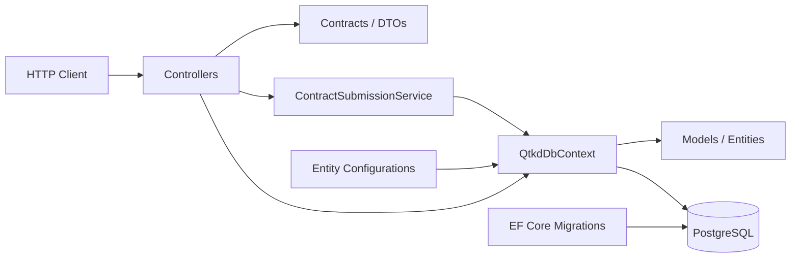
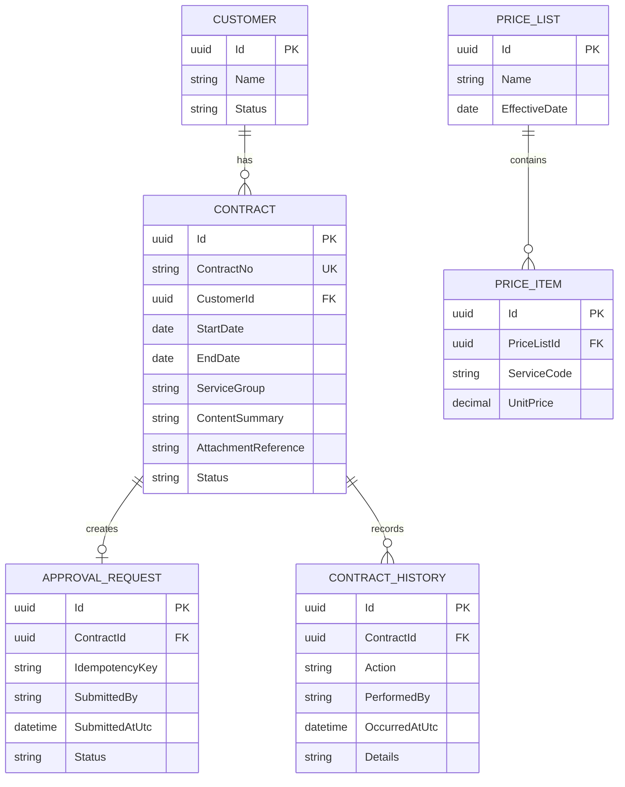

# QTKD API — Tuần 6

Web API quản trị kinh doanh được phát triển tiếp từ tuần 5, sử dụng ASP.NET Core, Entity Framework Core và PostgreSQL. Phiên bản tuần 6 bổ sung CRUD nghiệp vụ cho Customer, Contract, Pricing và luồng US03 gửi hợp đồng trình duyệt.

## Các thành phần chính của solution



- `QTKD.Api/Controllers`: cung cấp API Customer, Contract, PriceList và PriceItem; kiểm tra request và chuyển kết quả thành HTTP response.
- `QTKD.Api/Contracts`: chứa các DTO request/response, tách dữ liệu API khỏi entity lưu trong database.
- `QTKD.Api/Services/ContractSubmissionService`: xử lý US03, kiểm tra trạng thái và CTR-02, chống gửi lặp, tạo yêu cầu phê duyệt, chuyển sang `PendingApproval` và ghi lịch sử.
- `QTKD.Api/Models`: định nghĩa các entity `Customer`, `Contract`, `ApprovalRequest`, `ContractHistory`, `PriceList` và `PriceItem`.
- `QTKD.Api/Data/QtkdDbContext`: quản lý các `DbSet` và kết nối PostgreSQL thông qua EF Core/Npgsql.
- `QTKD.Api/Data/Configurations`: cấu hình tên bảng, quan hệ, độ dài trường, unique index và check constraint.
- `QTKD.Api/Data/SeedData`: cung cấp Customer, Contract, PriceList và PriceItem mẫu.
- `QTKD.Api/Data/Migrations`: chứa migration ban đầu và migration `Week06ContractSubmission` của tuần 6.
- `QTKD.Api/Program.cs`: đăng ký controller, JSON enum converter, DbContext, submission service và các endpoint nền tảng.

## Sơ đồ dữ liệu



Trong phạm vi tuần 6, mỗi Contract có tối đa một `ApprovalRequest`; unique index trên `ContractId` và cặp `ContractId`–`IdempotencyKey` ngăn tạo phiên phê duyệt trùng. Một Contract có thể có nhiều dòng `ContractHistory`. `ContentSummary`, `AttachmentReference` và `ServiceGroup` cho phép `NULL` khi lưu nháp; hai trường đầu phải có giá trị trước khi submit theo giả định demo CTR-02.

## Chạy ứng dụng

Yêu cầu chung: .NET SDK 10 và một PostgreSQL server đang hoạt động.

### Chuẩn bị PostgreSQL trên Ubuntu/WSL

Khởi động dịch vụ và đăng nhập bằng system user `postgres`:

```bash
sudo service postgresql start
sudo -u postgres psql
```

PostgreSQL trên Ubuntu thường sử dụng `peer authentication` cho local socket, vì vậy chạy `psql -U postgres` từ user Linux thông thường có thể bị từ chối.

Nếu đã đặt password cho role `postgres`, có thể buộc kết nối TCP thay vì local socket:

```bash
psql -h localhost -U postgres
```

### Chuẩn bị PostgreSQL trên Windows

1. Mở ứng dụng **Services** (`services.msc`) và bảo đảm dịch vụ có tên bắt đầu bằng `postgresql` đang ở trạng thái **Running**. Có thể kiểm tra trong PowerShell:

```powershell
Get-Service -Name "postgresql*"
```

Nếu dịch vụ chưa chạy, mở PowerShell bằng quyền Administrator và chạy lệnh sau, trong đó thay `<service-name>` bằng tên nhận được ở bước trên:

```powershell
Start-Service -Name "<service-name>"
```

2. Mở **SQL Shell (psql)** từ Start Menu. Giữ các giá trị mặc định cho server `localhost`, database `postgres`, port `5432`, username `postgres`, sau đó nhập password đã đặt khi cài PostgreSQL.

Nếu lệnh `psql` đã có trong `PATH`, có thể đăng nhập trực tiếp từ PowerShell:

```powershell
psql -h localhost -U postgres -d postgres
```

### Tạo database dùng chung cho cả hai môi trường

Sau khi đã vào `psql`, tạo user và database khớp với connection string mặc định của dự án:

```sql
CREATE USER qtkd WITH PASSWORD 'qtkd_dev_password';
CREATE DATABASE qtkd OWNER qtkd;
\q
```

Nếu user hoặc database đã tồn tại, bỏ qua lệnh tạo tương ứng. Nếu chỉ user đã tồn tại nhưng cần đặt lại password, chạy:

```sql
ALTER USER qtkd WITH PASSWORD 'qtkd_dev_password';
```

Đảm bảo PostgreSQL có thể truy cập tại `localhost:5432`.

Kiểm tra tài khoản ứng dụng qua kết nối TCP:

```bash
psql -h localhost -U qtkd -d qtkd
```

Nhập password `qtkd_dev_password` khi được hỏi, sau đó dùng `\q` để thoát.

### Chạy migration và Web API

Trên Ubuntu/WSL hoặc Windows, mở terminal tại thư mục gốc của repository rồi chạy:

```bash
dotnet tool restore
dotnet ef database update --project QTKD.Api --startup-project QTKD.Api
dotnet run --project QTKD.Api
```

Migration bổ sung của tuần 6 là `Week06ContractSubmission`.

Nếu muốn dùng database hoặc tài khoản khác, đặt connection string trước khi chạy migration và API.

Linux/macOS:

```bash
export ConnectionStrings__QTKD="Host=localhost;Port=5432;Database=qtkd;Username=postgres;Password=your_password"
```

Windows PowerShell:

```powershell
$env:ConnectionStrings__QTKD="Host=localhost;Port=5432;Database=qtkd;Username=postgres;Password=your_password"
```

## API tuần 6

- `GET /health`
- Customer: `POST /api/customers`, `GET /api/customers`, `GET /api/customers/{id}`, `PUT /api/customers/{id}`.
- Contract: `POST /api/contracts`, `GET /api/contracts`, `GET /api/contracts/{id}`, `PUT /api/contracts/{id}`.
- US03: `POST /api/contracts/{id}/submit`.
- Pricing: `POST /api/price-lists`, `GET /api/price-lists`, `GET /api/price-lists/{id}`.
- PriceItem: `POST /api/price-lists/{id}/items`, `GET /api/price-lists/{id}/items`.

Submit yêu cầu các header sau:

```http
X-User-Role: Sales
X-User-Id: sales-01
Idempotency-Key: submit-hd-2026-018-v1
```

`X-User-Role` là mô phỏng quyền trong phạm vi tuần 6; hệ thống xác thực/ủy quyền thật chưa thuộc phạm vi bài. Cùng một `Idempotency-Key` sẽ trả lại cùng `approvalId` và không tạo phiên phê duyệt thứ hai.

Vì Phase 1 chưa chốt danh sách nội dung/tệp bắt buộc, bản demo dùng hai giả định có chủ đích:

- `ContentSummary` không được trống.
- `AttachmentReference` không được trống.

Hai trường này chỉ mô phỏng CTR-02 và cần được thay bằng danh mục chính thức khi nghiệp vụ xác nhận.

Request/response và thứ tự demo đầy đủ nằm trong `QTKD.Api/QTKD.Api.http`. Báo cáo thực hiện nằm tại `BAO_CAO_TH6.md`.

Kịch bản trình bày có lời thoại và thời lượng từng bước nằm tại `docs/KICH_BAN_DEMO_5_PHUT.md`.

Seed data được đưa vào database qua EF Core migration, gồm khách hàng, hợp đồng `HD-2026-018`, bảng giá và các dòng giá mẫu. Có thể dùng file `QTKD.Api/QTKD.Api.http` để gọi thử API.
