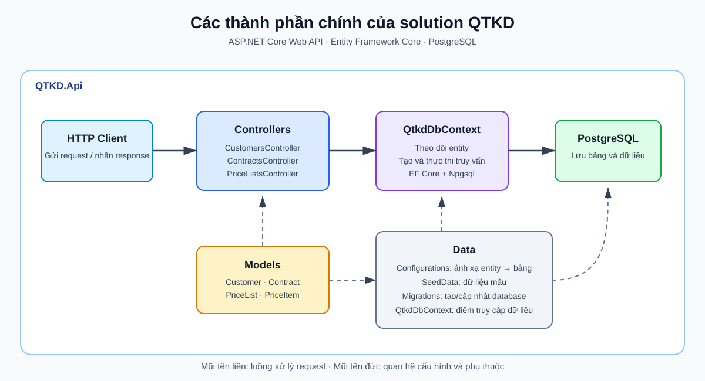
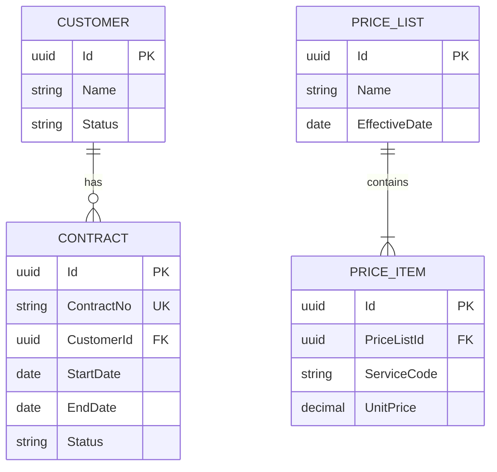

# QTKD API — Tuần 5

Nền tảng Web API cho hệ thống quản trị kinh doanh, sử dụng ASP.NET Core, Entity Framework Core và PostgreSQL.

## Các thành phần chính của solution



- `Controllers`: nhận HTTP request, truy vấn dữ liệu và trả HTTP response.
- `Models`: định nghĩa các entity nghiệp vụ.
- `Data/QtkdDbContext`: cầu nối giữa ứng dụng và PostgreSQL qua EF Core/Npgsql.
- `Data/Configurations`: cấu hình bảng, quan hệ, index và constraint.
- `Data/SeedData` và `Data/Migrations`: định nghĩa dữ liệu mẫu và lịch sử thay đổi database.

## Sơ đồ dữ liệu



## Chạy ứng dụng

Yêu cầu chung: .NET SDK 10 và một PostgreSQL server đang hoạt động.

### Chuẩn bị PostgreSQL trên Ubuntu/WSL

Khởi động dịch vụ và đăng nhập bằng system user `postgres`:

```bash
sudo service postgresql start
sudo -u postgres psql
```

PostgreSQL trên Ubuntu thường sử dụng `peer authentication` cho local socket, vì vậy chạy `psql -U postgres` từ user Linux thông thường có thể bị từ chối.

Nếu đã đặt password cho role `postgres`, có thể buộc kết nối TCP thay vì local socket:

```bash
psql -h localhost -U postgres
```

### Chuẩn bị PostgreSQL trên Windows

1. Mở ứng dụng **Services** (`services.msc`) và bảo đảm dịch vụ có tên bắt đầu bằng `postgresql` đang ở trạng thái **Running**. Có thể kiểm tra trong PowerShell:

```powershell
Get-Service -Name "postgresql*"
```

Nếu dịch vụ chưa chạy, mở PowerShell bằng quyền Administrator và chạy lệnh sau, trong đó thay `<service-name>` bằng tên nhận được ở bước trên:

```powershell
Start-Service -Name "<service-name>"
```

2. Mở **SQL Shell (psql)** từ Start Menu. Giữ các giá trị mặc định cho server `localhost`, database `postgres`, port `5432`, username `postgres`, sau đó nhập password đã đặt khi cài PostgreSQL.

Nếu lệnh `psql` đã có trong `PATH`, có thể đăng nhập trực tiếp từ PowerShell:

```powershell
psql -h localhost -U postgres -d postgres
```

### Tạo database dùng chung cho cả hai môi trường

Sau khi đã vào `psql`, tạo user và database khớp với connection string mặc định của dự án:

```sql
CREATE USER qtkd WITH PASSWORD 'qtkd_dev_password';
CREATE DATABASE qtkd OWNER qtkd;
\q
```

Nếu user hoặc database đã tồn tại, bỏ qua lệnh tạo tương ứng. Nếu chỉ user đã tồn tại nhưng cần đặt lại password, chạy:

```sql
ALTER USER qtkd WITH PASSWORD 'qtkd_dev_password';
```

Đảm bảo PostgreSQL có thể truy cập tại `localhost:5432`.

Kiểm tra tài khoản ứng dụng qua kết nối TCP:

```bash
psql -h localhost -U qtkd -d qtkd
```

Nhập password `qtkd_dev_password` khi được hỏi, sau đó dùng `\q` để thoát.

### Chạy migration và Web API

Trên Ubuntu/WSL hoặc Windows, mở terminal tại thư mục gốc của repository rồi chạy:

```bash
dotnet tool restore
dotnet ef database update --project QTKD.Api --startup-project QTKD.Api
dotnet run --project QTKD.Api
```

Nếu muốn dùng database hoặc tài khoản khác, đặt connection string trước khi chạy migration và API.

Linux/macOS:

```bash
export ConnectionStrings__QTKD="Host=localhost;Port=5432;Database=qtkd;Username=postgres;Password=your_password"
```

Windows PowerShell:

```powershell
$env:ConnectionStrings__QTKD="Host=localhost;Port=5432;Database=qtkd;Username=postgres;Password=your_password"
```

## API đọc dữ liệu mẫu

- `GET /health`
- `GET /api/customers` và `GET /api/customers/{id}`
- `GET /api/contracts` và `GET /api/contracts/{id}`
- `GET /api/price-lists` và `GET /api/price-lists/{id}`

Seed data được đưa vào database qua EF Core migration, gồm khách hàng, hợp đồng `HD-2026-018`, bảng giá và các dòng giá mẫu. Có thể dùng file `QTKD.Api/QTKD.Api.http` để gọi thử API.
