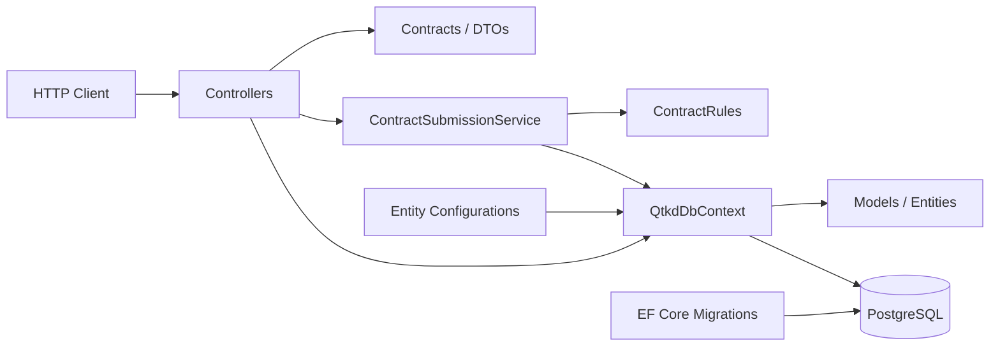
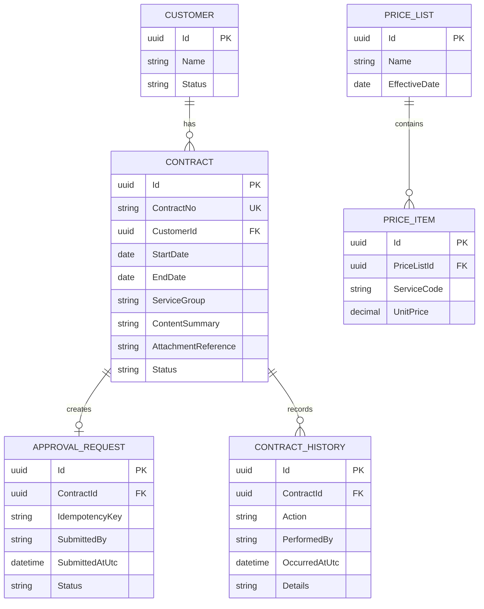

# QTKD API — Tuần 7

Tiếp tục solution .NET 10, ASP.NET Core Web API, Entity Framework Core và PostgreSQL từ TH6. Tuần 7 bổ sung xUnit, kiểm chứng TC01–TC08 và sửa lỗi phản hồi khi client yêu cầu chuyển thẳng sang Approved.

Thư mục TH7 kế thừa mã nguồn và thư mục Git của TH6 theo yêu cầu tạo thư mục riêng. Các migration tuần 5–6 được giữ để chạy trên database cũ hoặc tạo database mới.

## Cấu trúc

- `QTKD.Api` chứa controllers, contracts, services, entities và EF Core migrations.
- `tests/QTKD.Tests/Unit` kiểm tra CTR-01, CTR-02 và CTR-03 bằng các hàm nghiệp vụ mà API/service đang sử dụng.
- `tests/QTKD.Tests/Integration` gọi API qua WebApplicationFactory và xác minh trực tiếp PostgreSQL.
- `docs/test-results/week07.trx` lưu kết quả kiểm thử thực tế.
- `BAO_CAO_TH7.md` mô tả yêu cầu, cách thực hiện, lỗi sửa và bảng TC01–TC08.
- `requirements/general/TH_Phase2_QTKD.pdf` chứa đề bài gốc, mục 5 là tuần 7.

## Các thành phần chính



- `QTKD.Api/Controllers` cung cấp API Customer, Contract và Pricing; kiểm tra request và trả HTTP response.
- `QTKD.Api/Contracts` chứa các DTO request/response, tách dữ liệu API khỏi entity.
- `ContractSubmissionService` xử lý gửi hợp đồng, chống gửi lặp, tạo yêu cầu phê duyệt và ghi lịch sử; `ContractRules` tập trung các điều kiện CTR-01–03.
- `QtkdDbContext`, configurations và migrations quản lý mô hình dữ liệu PostgreSQL. `SeedData` tạo dữ liệu mẫu.

## Sơ đồ dữ liệu



Mỗi Contract có tối đa một ApprovalRequest và có thể có nhiều dòng ContractHistory. ContentSummary, AttachmentReference và ServiceGroup có thể để trống khi lưu Draft; hai trường đầu cần giá trị trước khi submit theo giả định demo CTR-02.

## Cấu hình và chạy API

Cần .NET SDK 10 và PostgreSQL đang chạy. Tạo role/database riêng cho ứng dụng bằng tài khoản quản trị PostgreSQL.

```sql
CREATE ROLE qtkd LOGIN PASSWORD '<mat-khau-ban-tu-dat>';
CREATE DATABASE qtkd OWNER qtkd;
```

Tại thư mục TH7, đặt connection string bằng biến môi trường. Ví dụ Bash trên Linux/WSL.

```bash
export ConnectionStrings__QTKD='Host=localhost;Port=5432;Database=qtkd;Username=qtkd;Password=<mat-khau-ban-tu-dat>'
dotnet restore QTKD.slnx
dotnet tool restore
dotnet ef database update --project QTKD.Api --startup-project QTKD.Api
dotnet run --project QTKD.Api
```

PowerShell đặt biến tương ứng trước khi chạy các lệnh dotnet trên.

```powershell
$env:ConnectionStrings__QTKD = 'Host=localhost;Port=5432;Database=qtkd;Username=qtkd;Password=<mat-khau-ban-tu-dat>'
```

Dùng URL API in trên console, mở `QTKD.Api/QTKD.Api.http` và chỉnh `@host` nếu cần. File HTTP và `docs/KICH_BAN_DEMO_5_PHUT.md` giữ luồng demo tuần 6. Submit yêu cầu `X-User-Role: Sales`, `X-User-Id` và `Idempotency-Key`.

API hỗ trợ tạo/xem/cập nhật Customer và Contract, gửi Contract, tạo/xem PriceList, thêm/xem PriceItem. `GET /health` kiểm tra ứng dụng. Khi POST/PUT Contract có `status` yêu cầu thay đổi trái phép, API trả 409 với `CONTRACT_STATE_INVALID`. POST mặc định Draft, submit chuyển Draft sang PendingApproval.

## Chạy kiểm thử

Unit test chạy độc lập với PostgreSQL.

```bash
dotnet test QTKD.slnx --filter 'FullyQualifiedName~QTKD.Tests.Unit'
```

Integration test cần PostgreSQL và role có quyền CREATEDB. Trong PostgreSQL quản trị, chuẩn bị role chuyên dùng kiểm thử.

```sql
CREATE ROLE qtkd_test LOGIN CREATEDB PASSWORD '<mat-khau-test>';
```

Bash đặt kết nối tới database quản trị của server kiểm thử rồi chạy toàn bộ test.

```bash
export QTKD_TEST_ADMIN='Host=127.0.0.1;Port=5432;Database=postgres;Username=qtkd_test;Password=<mat-khau-test>'
dotnet test QTKD.slnx --logger 'trx;LogFileName=week07.trx' --results-directory docs/test-results
```

PowerShell dùng biến tương ứng.

```powershell
$env:QTKD_TEST_ADMIN = 'Host=127.0.0.1;Port=5432;Database=postgres;Username=qtkd_test;Password=<mat-khau-test>'
```

Fixture tạo database có tên `qtkd_test_<GUID>`, chạy migration thật, dùng database đó cho API và truy vấn kiểm chứng, sau đó xóa đúng database đã tạo. Mỗi lần chạy tạo tên mới. Nếu tiến trình bị dừng cưỡng bức, database test có thể còn lại và cần được dọn riêng. Connection string ứng dụng và connection string kiểm thử được cấu hình độc lập.

Trong lần kiểm chứng tại máy này, server tạm chạy tại `127.0.0.1:55437`, role `qtkd_test`, database quản trị `postgres`, xác thực trust trên localhost. Đây cũng là giá trị mặc định của fixture nếu chưa đặt `QTKD_TEST_ADMIN`.

TC06 tự động chạy luồng tạo Customer → Contract Draft thiếu dữ liệu → submit thất bại → bổ sung dữ liệu → submit thành công → GET và truy vấn DB. TC08 kiểm tra gửi lại cùng key và khác key. Test bổ sung kiểm tra submit đồng thời, quyền Sales và Pricing.

## Giả định nghiệp vụ và giới hạn

CTR-02 tiếp tục giả định `ContentSummary` và `AttachmentReference` không trống vì Phase 1 chưa chốt danh mục bắt buộc. Quyền Sales mô phỏng bằng header. Approval hiện tạo một yêu cầu và lịch sử submit. Database test chạy thật, API integration chạy trong TestServer. Demo tương tác và việc clone trên máy khác vẫn cần người nộp bài thực hiện theo hướng dẫn này.
